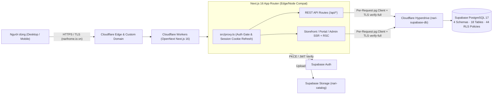

<div align="center">

# Nari Home — O2O E-Commerce, Clinic Booking & Enterprise ERP Platform

**Hệ thống thương mại điện tử Mỹ phẩm, Đặt lịch Phòng khám Da liễu (Clinic & Spa) và Quản trị Doanh nghiệp (ERP) chuẩn Production — chạy trên Next.js 16, Supabase PostgreSQL 17 & Cloudflare Workers.**

[](https://narihome.io.vn)
[](https://nextjs.org/)
[](https://react.dev/)
[](https://www.typescriptlang.org/)
[](https://supabase.com/)
[](https://workers.cloudflare.com/)

</div>

---

## Mục lục

1. [Tổng quan hệ thống](#1-tổng-quan-hệ-thống)
2. [Kiến trúc hệ thống](#2-kiến-trúc-hệ-thống)
3. [Công nghệ sử dụng (Tech Stack)](#3-công-nghệ-sử-dụng-tech-stack)
4. [Cấu trúc thư mục](#4-cấu-trúc-thư-mục)
5. [Kiến trúc Cơ sở dữ liệu PostgreSQL (4 Schemas, 18 Bảng, 44 RLS Policies)](#5-kiến-trúc-cơ-sở-dữ-liệu-postgresql)
6. [Hệ thống Route & API chính](#6-hệ-thống-route--api-chính)
7. [Bảo mật, Xác thực & Phân quyền RBAC](#7-bảo-mật-xác-thực--phân-quyền-rbac)
8. [Hướng dẫn cài đặt & Chạy cục bộ](#8-hướng-dẫn-cài-đặt--chạy-cục-bộ)
9. [Triển khai Production (Cloudflare Workers + Supabase)](#9-triển-khai-production-cloudflare-workers--supabase)
10. [Kiểm thử & Quality Gate](#10-kiểm-thử--quality-gate)

---

## 1. Tổng quan hệ thống

**Nari Home** (*"Khơi nguồn vẻ đẹp - Kiến tạo khí chất"*) là nền tảng bán lẻ đa kênh O2O kết hợp 4 phân hệ cốt lõi trên cùng một codebase Next.js App Router:

- **Storefront Thương mại điện tử:** Trang chủ, danh mục & bộ lọc đa chiều, tìm kiếm nhanh, trang chi tiết sản phẩm, Mini Cart Drawer (kèm thanh tiến độ miễn phí giao nhanh **NariNow 2H**), giỏ hàng, thanh toán COD / chuyển khoản VietQR, chọn chi nhánh giao hàng và tra cứu đơn hàng theo mã + SĐT.
- **Clinic & Spa Booking:** Bảng giá dịch vụ da liễu, hệ thống cửa hàng/chi nhánh từ PostgreSQL và đặt lịch hẹn chống trùng lịch trực tiếp ở tầng database (`EXCLUDE USING gist`).
- **Cổng Khách hàng (`/khach-hang/*`):** Đăng ký, đăng nhập, khôi phục mật khẩu qua Supabase Auth PKCE, quản lý hồ sơ khách hàng, lịch sử đơn hàng và lịch hẹn clinic.
- **Cổng Quản trị ERP & Sản phẩm (`/quan-tri`, `/quan-tri/san-pham`) & Cổng Nhân viên (`/nhan-vien/*`):** Quản trị CRM khách hàng, nhân sự RBAC, xử lý đơn hàng Fulfillment, tồn kho đa chi nhánh (có audit log), quản lý sản phẩm/banner và upload ảnh trực tiếp lên Supabase Storage.

> **Nhận diện giao diện:** Luxury Silk & Pearl Champagne (`#faf5f0`, `#f6ece3`, Deep Espresso `#3d2e24`, Warm Terracotta `#b86b4b`), dùng 100% Local Fonts OFL (`Be Vietnam Pro` & `Cormorant Garamond` trong `src/app/fonts/`), hỗ trợ Shimmer Skeletons, Route Progress Loader và Code-Splitting (`next/dynamic`).

---

## 2. Kiến trúc hệ thống



### Nguyên tắc kiến trúc nổi bật
- **100% Authoritative PostgreSQL:** Không dùng SQLite hay in-memory mock cho dữ liệu vận hành; mọi tính giá giỏ hàng (`/api/cart/quote`), tồn kho và đơn hàng đều được máy chủ tính toán trực tiếp từ PostgreSQL.
- **Hyperdrive Per-Request Adapter (`src/lib/server/postgres-database.ts`):** Khởi tạo `pg.Client` riêng theo từng `query`/`transaction` và đóng an toàn trong `finally` để tuân thủ mô hình cô lập I/O của Cloudflare `workerd`, tự động fallback về `pg.Pool` khi chạy Node.js cục bộ.
- **White-Label tập trung (`src/lib/brand-config.ts`):** Toàn bộ tên thương hiệu, slogan, domain, hotline, email và dịch vụ được quản lý qua biến môi trường `NEXT_PUBLIC_BRAND_*` kèm bộ lọc chống lỗi mã hóa tiếng Việt (`sanitizeBrandString`).

---

## 3. Công nghệ sử dụng (Tech Stack)

| Lớp hệ thống | Công nghệ / Thư viện | Phiên bản | Vai trò |
| :--- | :--- | :--- | :--- |
| **Framework** | Next.js (App Router, Turbopack) | `16.4.6` | SSR, RSC, Route Handlers, `src/proxy.ts` |
| **UI Runtime** | React & React DOM (React Compiler) | `19.2.4` | Giao diện tương tác, `useSyncExternalStore`, `Suspense` |
| **Ngôn ngữ** | TypeScript (Strict Mode, no `any`) | `5.x` | An toàn kiểu toàn bộ FE/BE & DTO |
| **Styling & UI** | Tailwind CSS v4, shadcn/ui, `@base-ui/react`, `lucide-react` | `4.x` / `1.6.0` | Design tokens Luxury Silk, component tái sử dụng |
| **Database** | PostgreSQL 17 (Supabase) + driver `pg` | `8.23.1` | ACID transactions, RLS, `btree_gist`, `FOR NO KEY UPDATE` |
| **Auth & Storage** | `@supabase/supabase-js`, `@supabase/ssr` | `2.119.0` / `0.12.7` | Đăng nhập PKCE, session cookie SSR, lưu ảnh sản phẩm |
| **Edge Deployment** | `@opennextjs/cloudflare`, `wrangler`, Cloudflare Hyperdrive | `1.20.17` / `4.164.0` | Chạy Next.js fullstack trên Cloudflare Workers |
| **Code Intelligence** | `@colbymchenry/codegraph` | `1.6.2` | Chỉ mục biểu đồ mã nguồn & phân tích blast radius |
| **Testing & Lint** | `node:test`, ESLint 9 (`eslint-config-next`), TypeScript | Node `>= 24` | 92+ unit/integration tests, 0 lỗi lint/typecheck |

---

## 4. Cấu trúc thư mục

```text
.
├── src/
│   ├── proxy.ts                     # Next.js 16 Proxy: xác thực cookie & bảo vệ /quan-tri, /khach-hang, /nhan-vien
│   ├── app/                         # Next.js App Router (Pages, loading.tsx, robots.ts, sitemap.ts)
│   │   ├── fonts/                   # Local OFL fonts (Be Vietnam Pro, Cormorant Garamond)
│   │   ├── api/                     # Backend REST API Routes
│   │   │   ├── admin/               # ERP & Catalog Admin APIs (products, orders, inventory, users, staff, upload, seo)
│   │   │   ├── auth/                # Đăng ký (/register), khôi phục mật khẩu (/recovery)
│   │   │   ├── bookings/            # Đặt lịch Clinic PostgreSQL
│   │   │   ├── cart/quote/          # Báo giá giỏ hàng & VietQR chuẩn server
│   │   │   ├── customer/portal/     # API cổng khách hàng (hồ sơ, đơn hàng, lịch hẹn)
│   │   │   ├── orders/              # Tạo đơn ACID, tra cứu & hủy đơn
│   │   │   ├── payments/webhook/    # Webhook thanh toán HMAC-SHA256 + idempotency
│   │   │   ├── products/            # API danh mục & chi tiết sản phẩm
│   │   │   ├── session/             # Phiên đăng nhập Supabase SSR
│   │   │   └── stores/              # Danh sách chi nhánh PostgreSQL
│   │   ├── (storefront routes)/     # /, /san-pham/[slug], /danh-muc/[slug], /gio-hang, /thanh-toan, /booking...
│   │   ├── khach-hang/[section]/    # Cổng thông tin khách hàng
│   │   ├── nhan-vien/[workspace]/   # Khung làm việc nhân viên theo vai trò
│   │   └── quan-tri/                # Admin ERP (/quan-tri) & Quản lý sản phẩm (/quan-tri/san-pham)
│   ├── components/
│   │   ├── ui/                      # shadcn/ui primitives dùng chung
│   │   └── sites/nari/              # Toàn bộ UI storefront, Mini Cart, Checkout, Booking, Skeletons, Admin ERP
│   └── lib/
│       ├── brand-config.ts          # Cấu hình thương hiệu white-label tập trung
│       ├── cart.ts                  # Store giỏ hàng reactive (useSyncExternalStore)
│       ├── backend-contracts.ts     # DTO & hợp đồng dữ liệu FE↔BE
│       ├── seo/seo-engine.ts        # Schema.org JSON-LD & SEO health scorer
│       └── server/                  # Lớp nghiệp vụ server & PostgreSQL services
│           ├── postgres-database.ts         # Hyperdrive per-request adapter + pg.Pool fallback
│           ├── postgres-catalog-service.ts  # Catalog, sản phẩm, danh mục, banner
│           ├── postgres-order-service.ts    # Đặt hàng ACID, khóa tồn kho, idempotency
│           ├── postgres-clinic-service.ts   # Chi nhánh & đặt lịch chống trùng slot
│           ├── postgres-customer-service.ts # Hồ sơ khách hàng & portal
│           ├── postgres-erp-service.ts      # Admin ERP (CRM, đơn hàng, tồn kho, nhân sự)
│           ├── postgres-payment-webhook-service.ts # Xác thực HMAC-SHA256 & cập nhật thanh toán
│           ├── supabase-principal.ts        # Giải mã danh tính & phân quyền từ provisioned_identities
│           └── access-policy.ts             # Chính sách RBAC & phạm vi chi nhánh
├── db/
│   └── migrations/                  # 6 migration SQL chuẩn hóa cho 4 schemas + RLS
├── scripts/                         # Công cụ CLI vận hành (ops-cli, push-supabase-schema, verify-supabase-live, seed)
├── test/                            # Bộ test tự động Node.js & PGlite
├── docs/                            # Tài liệu kiến trúc, quy tắc kỹ thuật, SESSION_HANDOFF & gap report
├── wrangler.jsonc                   # Cấu hình Cloudflare Workers, Hyperdrive & Custom Domain
├── open-next.config.ts              # Cấu hình @opennextjs/cloudflare
└── .github/workflows/ci.yml         # Pipeline CI tự động (tests, typecheck, lint, build)
```

---

## 5. Kiến trúc Cơ sở dữ liệu PostgreSQL

Cơ sở dữ liệu chạy trên **Supabase PostgreSQL 17**, tách bạch ranh giới nghiệp vụ thành **4 schemas**, **18 bảng** và **44 Row-Level Security (RLS) policies**, vận hành qua role runtime ít đặc quyền **`nari_catalog_app`**:

| Schema | Các bảng chính | Cơ chế bảo vệ dữ liệu |
| :--- | :--- | :--- |
| **`nari_catalog`** | `sources`, `brands`, `categories`, `products`, `product_images`, `product_specs`, `home_banners`, `branches`, `inventory_balances`, `inventory_movements` | Khóa hàng `SELECT ... FOR NO KEY UPDATE`, nhật ký biến động tồn kho bất biến |
| **`nari_identity`** | `provisioned_identities`, `customer_profiles`, `rate_limit_buckets` | `provisioned_identities` chỉ cho phép `SELECT` ở runtime (cấp quyền nhân sự out-of-band); rate limit phân tán trên DB |
| **`nari_orders`** | `orders`, `order_items`, `order_events`, `idempotency_keys` | Giao dịch ACID đặt hàng/hủy hàng, khóa chống trùng request (`idempotency_keys`), optimistic locking |
| **`nari_clinic`** | `services`, `appointments` | Extension `btree_gist` + ràng buộc `EXCLUDE USING gist` ngăn trùng lịch hẹn theo chi nhánh ở tầng DB |

Danh sách migration trong `db/migrations/`:
1. `202611160001_catalog_inventory.sql` — Schema `nari_catalog`, sản phẩm, tồn kho, RLS.
2. `202611170001_identity.sql` — Schema `nari_identity` & `provisioned_identities`.
3. `202611170003_catalog_reference_authoring.sql` — Banner trang chủ & tham chiếu catalog authoring.
4. `202611180001_auth_ratelimit_customers.sql` — Distributed rate limiter & `customer_profiles`.
5. `202611180002_orders_fulfillment.sql` — Đơn hàng ACID, `order_items`, `order_events`, `idempotency_keys`.
6. `202611180003_clinic_bookings.sql` — Chi nhánh, dịch vụ clinic & đặt lịch `EXCLUDE USING gist`.

---

## 6. Hệ thống Route & API chính

### Giao diện (App Router)
- **Storefront:** `/`, `/danh-muc/[slug]`, `/san-pham/[slug]`, `/thuong-hieu`, `/thuong-hieu/[slug]`, `/tim-kiem`, `/deals-dang-dien-ra.html`, `/san-pham-ban-chay.html`, `/hang-moi-ve.html`, `/he-thong-cua-hang`, `/ho-tro`, `/bao-hanh`
- **Mua hàng & Đặt lịch:** `/gio-hang`, `/thanh-toan`, `/tra-cuu-don-hang`, `/booking`, `/bang-gia-dich-vu.html`, `/dich-vu/[slug]`
- **Xác thực & Tài khoản:** `/dang-nhap`, `/dang-ky`, `/khoi-phuc-mat-khau`, `/auth/callback`, `/khach-hang/[section]`
- **Nội bộ & Quản trị:** `/quan-tri`, `/quan-tri/san-pham`, `/nhan-vien/[workspace]`

### API Endpoints tiêu biểu
- **Public / Storefront:** `GET /api/products`, `GET /api/products/[slug]`, `GET /api/stores`, `POST /api/cart/quote`, `POST /api/orders`, `GET /api/orders`, `PATCH /api/orders`, `POST /api/bookings`
- **Auth & Customer:** `GET/POST/DELETE /api/session`, `POST /api/auth/register`, `POST /api/auth/recovery`, `GET/PATCH /api/customer/portal`
- **Admin ERP & Catalog (yêu cầu Supabase Principal + RBAC):** `/api/admin/products`, `/api/admin/upload`, `/api/admin/orders`, `/api/admin/inventory`, `/api/admin/users`, `/api/admin/staff`, `/api/admin/seo`
- **Thanh toán:** `POST /api/payments/webhook` (HMAC-SHA256, chống replay, idempotent, mặc định fail-closed `503` khi chưa bật secret)

---

## 7. Bảo mật, Xác thực & Phân quyền RBAC

- **Fail-closed mặc định:** Các tính năng nhạy cảm (`NARI_AUTH_ENABLED`, `NARI_ORDERS_ENABLED`, `NARI_BOOKINGS_ENABLED`, `NARI_ERP_ADMIN_ENABLED`, `NARI_PAYMENT_WEBHOOK_ENABLED`) chỉ mở khi được cấu hình tường minh.
- **Next.js 16 Proxy (`src/proxy.ts`):** Làm mới cookie Supabase SSR và chặn sớm truy cập chưa đăng nhập vào `/quan-tri/*`, `/khach-hang/*`, `/nhan-vien/*` (trả `307` về `/dang-nhap?redirect=...`).
- **Chống CSRF nghiêm ngặt:** Mọi mutation dùng cookie đều kiểm tra khớp chính xác `Origin` với `APP_ORIGIN`.
- **Distributed Rate Limiting:** Giới hạn tần suất đăng nhập/đăng ký/khôi phục mật khẩu lưu trực tiếp trên PostgreSQL (`nari_identity.rate_limit_buckets`), hoạt động nhất quán trên serverless edge.
- **TLS `verify-full`:** Kết nối PostgreSQL xác thực chứng chỉ gốc Supabase Root CA (`NARI_POSTGRES_CA`).

---

## 8. Hướng dẫn cài đặt & Chạy cục bộ

### Yêu cầu môi trường
- **Node.js `>= 24`** (`npm` đi kèm)
- Tài khoản **Supabase** (PostgreSQL + Auth + Storage) và **Cloudflare** (nếu deploy Workers)

### Các bước thiết lập
```bash
# 1. Cài đặt dependencies
npm install

# 2. Tạo file biến môi trường từ mẫu và điền thông tin kết nối Supabase/Brand
cp .env.example .env

# 3. Kiểm tra trạng thái môi trường & kết nối Cloud
npm run ops:doctor -- --live

# 4. (Tùy chọn) Kiểm tra & đẩy schema lên Supabase bằng DATABASE_URL quyền owner
npm run db:push -- --dry-run --wave3-backend
npm run db:push -- --apply --wave3-backend

# 5. Xác minh 18 bảng & 44 RLS policies
npm run db:verify

# 6. Chạy server phát triển cục bộ
npm run dev
```

### Danh sách lệnh thường dùng
| Lệnh | Mô tả |
| :--- | :--- |
| `npm run dev` | Khởi chạy Next.js dev server (`http://localhost:3000`) |
| `npm run typecheck` | Kiểm tra TypeScript strict toàn dự án (`tsc --noEmit`) |
| `npm run lint` | Kiểm tra ESLint 9 + React Compiler rules |
| `npm run build` | Production build Next.js tiêu chuẩn |
| `npm run check` | Chạy tuần tự `lint` + `typecheck` + `build` |
| `node --test test/*.mjs test/*.cjs` | Chạy toàn bộ bộ test tự động |
| `npm run ops:doctor -- --live` | Kiểm tra nhanh Node, CLI, biến môi trường, Supabase DB & Wrangler |
| `npm run db:verify` | Xác minh TLS, RLS policies và đếm bản ghi trên Supabase |
| `npm run cf:build` | Đóng gói bundle OpenNext cho Cloudflare Workers (`.open-next/worker.js`) |

---

## 9. Triển khai Production (Cloudflare Workers + Supabase)

Hệ thống đang chạy live tại **[https://narihome.io.vn](https://narihome.io.vn)** với Cloudflare Hyperdrive (`nari-supabase-db`) và Custom Domain SSL tự động.

```bash
# 1. Nạp secrets lên Cloudflare Workers (chỉ cần chạy khi đổi secret)
npx wrangler secret put NARI_POSTGRES_URL
npx wrangler secret put NARI_POSTGRES_CA
npx wrangler secret put NEXT_PUBLIC_SUPABASE_PUBLISHABLE_KEY
npx wrangler secret put SUPABASE_SERVICE_ROLE_KEY

# 2. Build OpenNext bundle
npm run cf:build

# 3. Deploy lên Cloudflare Workers (narihome.io.vn & www.narihome.io.vn)
# Trên Windows PowerShell:
$env:CLOUDFLARE_HYPERDRIVE_LOCAL_CONNECTION_STRING_HYPERDRIVE="postgresql://127.0.0.1:5432/local"
npx wrangler deploy
```

> **Lưu ý cấu hình Supabase Auth:** Trong *Supabase Dashboard → Authentication → URL Configuration*, khai báo Redirect URLs:
> - `https://narihome.io.vn/auth/callback`
> - `https://narihome.io.vn/khoi-phuc-mat-khau`

---

## 10. Kiểm thử & Quality Gate

Trước mỗi lần đẩy code lên `main`, dự án duy trì cổng chất lượng bắt buộc (khớp [`.github/workflows/ci.yml`](.github/workflows/ci.yml)):
- `node --test test/*.mjs test/*.cjs` — **0 failed** (hỗ trợ tích hợp PostgreSQL cục bộ qua `@electric-sql/pglite` khi đặt `NARI_TEST_PGLITE_PATH`).
- `npm run typecheck` — **0 errors**.
- `npm run lint` — **0 errors, 0 warnings**.
- `npm run cf:build` — đóng gói sạch `.open-next/worker.js`.

---

## Tài liệu liên quan

- [docs/ENGINEERING_RULES.md](docs/ENGINEERING_RULES.md) — Quy chuẩn kỹ thuật, bảo mật và tiêu chí nghiệm thu.
- [docs/DATABASE_ARCHITECTURE.md](docs/DATABASE_ARCHITECTURE.md) — Thiết kế cơ sở dữ liệu chi tiết.
- [docs/SESSION_HANDOFF.md](docs/SESSION_HANDOFF.md) — Nhật ký bàn giao các phiên triển khai.
- [PROGRESS.md](PROGRESS.md) — Tiến độ dự án qua từng mốc phát triển.

---

## License

MIT
