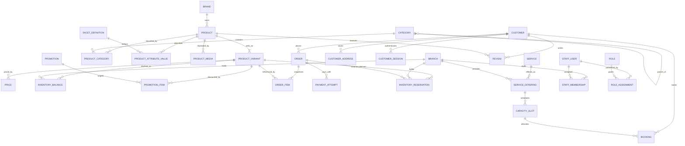

# Kiến trúc cơ sở dữ liệu và định hướng triển khai

**Trạng thái:** Đây là thiết kế đề xuất cho ứng dụng lấy cảm hứng từ Hasaki, không mô tả hệ thống riêng của Hasaki. Chưa provision cơ sở dữ liệu, chưa thêm package và chưa migrate dữ liệu production. Ngày lập: 2026-11-14.

## Bằng chứng công khai cho biết điều gì

Các trang Hasaki công khai thể hiện hệ thống storefront gồm cây danh mục, trang thương hiệu có bộ lọc, sản phẩm có biến thể như dung tích/màu, mục “Chi nhánh còn sản phẩm”, khuyến mãi giới hạn theo thời gian/số lượng, đánh giá/hỏi đáp và dịch vụ Clinic có đặt lịch theo chi nhánh/thời gian. Ví dụ, [trang thương hiệu Cocoon](https://hasaki.vn/thuong-hieu/cocoon.html) hiển thị danh mục, khoảng giá, thành phần, loại da/tóc, công dụng và loại sản phẩm; [trang danh mục](https://hasaki.vn/danh-muc/cham-soc-da-mat-c4.html) có thẻ sản phẩm cùng giá, đánh giá/lượt bán và quà tặng; dữ liệu trích xuất từ trang sản phẩm có tên biến thể và tồn kho theo chi nhánh ([ví dụ](https://hasaki.vn/san-pham/son-kem-bun-into-you-li-min-nhe-w3-do-dat-1-8g-137191.html)); trang hỗ trợ dịch vụ khuyến nghị đặt hẹn trước ([trang hỗ trợ](https://hotro.hasaki.vn/dich-vu-spa.html)). Những quan sát này chỉ xác định khái niệm hiển thị trên trang. Chúng **không** cho biết schema, hệ quản trị cơ sở dữ liệu, dịch vụ nội bộ, quy tắc tồn kho hay quyền sở hữu dữ liệu của Hasaki.

Thiết kế quan hệ bên dưới là suy luận cho bản clone này. Dữ liệu quan sát/trích xuất phải được nhập vào vùng staging có provenance; không coi snapshot giá, tồn kho, đánh giá hoặc đồng hồ khuyến mãi là dữ liệu nghiệp vụ hiện hành. Quy tắc kỹ thuật hiện tại của repo cũng chọn PostgreSQL làm nguồn dữ liệu nghiệp vụ dự kiến và Prisma làm ORM được đề xuất; tài liệu đó nêu rõ đây là yêu cầu định hướng, chưa phải tính năng đã triển khai.

## Mô hình miền đề xuất

Dùng một cơ sở dữ liệu PostgreSQL và một modular monolith. Tổ chức mã theo miền: `catalog`, `pricing-promotions`, `inventory`, `identity`, `orders`, `bookings`, và `support`. Sơ đồ thể hiện các quan hệ chính, không phải toàn bộ cột hay bảng tích hợp.

### Danh mục và trưng bày

- **Product** lưu nội dung người mua nhìn thấy: tên, thương hiệu, mô tả, trạng thái xuất bản. **ProductVariant** là đơn vị bán được, sở hữu SKU/barcode duy nhất, quy cách đóng gói, màu/mùi, mã công bố và media/thuộc tính riêng của biến thể. Sản phẩm chỉ có một quy cách vẫn có một variant. Không dùng slug sản phẩm làm khóa tồn kho.
- **Category** là cây phân cấp; `ProductCategory` cho phép một sản phẩm nằm trong nhiều nhánh. Lưu slug URL riêng với nhãn hiển thị. Ràng buộc khóa ngoại parent-child không tự ngăn chu trình; khi đổi parent phải kiểm tra để không cho danh mục trở thành tổ tiên của chính nó. Có thể dùng bảng closure hoặc đường dẫn materialized nếu cần truy vấn tổ tiên nhanh; chọn sau khi đo nhu cầu.
- **FacetDefinition** xác định thuộc tính lọc theo category hoặc product type, gồm kiểu dữ liệu, đơn vị và thứ tự hiển thị. Lưu giá trị chuẩn hóa trong bảng thuộc tính (hoặc cột có kiểu khi cần truy vấn/kiểm tra chặt). Tránh gom dữ liệu lọc cốt lõi vào JSON không có kiểu. Số lượng cạnh bộ lọc được tính từ tập kết quả hiện hành, không hardcode riêng.
- **Brand** lưu nội dung, slug và tham chiếu logo của thương hiệu. Ảnh sản phẩm nằm trong object storage/CDN; `ProductMedia` chỉ lưu URL/key, vai trò, alt text và thứ tự, không chứa binary ảnh trong bảng quan hệ.
- **Price** gồm số tiền VND kiểu integer, currency, channel và khoảng hiệu lực. Khi cần kiểm toán, lưu lịch sử giá bất biến hoặc các hàng có thời gian hiệu lực. “Giảm giá” trên giao diện phải suy ra theo chính sách giá gốc/giá hiện tại rõ ràng, không bịa từ một con số scrape.
- **Promotion** và bảng điều kiện/đối tượng áp dụng lưu lịch chạy, điều kiện, giới hạn số lượng, quà tặng, quy tắc cộng dồn và channel. Việc tính ưu đãi phải chạy phía server. Thẻ hoặc đồng hồ khuyến mãi ở client chỉ trình bày dữ liệu chiến dịch có thẩm quyền.

### Tồn kho và đơn hàng

- **Branch** là cửa hàng/chi nhánh hiển thị cho khách; tách riêng warehouse vận hành nếu cần điều chuyển/bổ sung hàng. `InventoryBalance` có đúng một hàng cho mỗi `(branch_id, variant_id)`, với tồn thực tế/tồn giữ không âm và version để kiểm soát cạnh tranh lạc quan. Unique SKU ở cấp variant đảm bảo truy vấn tồn theo chi nhánh cũng là duy nhất theo `(branch_id, SKU)` thông qua variant. Sổ kho dạng append-only ghi nhận nhập, bán, điều chỉnh, điều chuyển và giữ/nhả hàng kèm actor, lý do và tham chiếu nguồn.
- **InventoryReservation** gắn variant, branch, số lượng và thời điểm hết hạn với lần checkout/đơn hàng. Hết hạn/nhả giữ hàng là chuyển trạng thái tường minh. Chặn bán vượt tồn bằng cập nhật nguyên tử có điều kiện hoặc khóa hàng trong transaction ngắn; không tính tồn khả dụng chỉ từ bộ nhớ ứng dụng.
- **Order** lưu `customer_id` dạng FK nullable cho khách vãng lai, phương thức giao/nhận, currency, trạng thái, tổng tiền và snapshot địa chỉ/liên hệ tại thời điểm đặt. **OrderItem** lưu snapshot bất biến của SKU, tên sản phẩm/variant, đơn giá, thuế/giảm giá/quà tặng và số lượng; có thể giữ FK tham chiếu catalog nhưng không phụ thuộc FK để hiển thị hóa đơn lịch sử. Không dùng cascade xóa làm mất đơn; sửa danh mục không được viết lại biên nhận cũ.
- **PaymentAttempt** lưu mã tham chiếu nhà cung cấp, số tiền/currency, trạng thái và idempotency key, không lưu thông tin thẻ. Webhook phải xác thực chữ ký, chống ghi nhận trùng và kiểm tra chuyển trạng thái. Gọi hệ thống thanh toán/vận chuyển bên ngoài ngoài transaction DB; nếu tích hợp, lưu outbox/job cho side effect cần retry.
- Thêm `IdempotencyRecord` với khóa unique theo `(owner_scope, endpoint, idempotency_key)`; lưu hash của request và tham chiếu response/kết quả. `owner_scope` là định danh khách hàng đã xác thực hoặc định danh phiên guest có kiểm soát. Gửi lại cùng key và cùng request trả lại cùng kết quả; dùng lại key với request hash khác phải bị từ chối.

### Danh tính, Clinic, đánh giá và hỗ trợ

- Tách **Customer** khỏi thông tin đăng nhập. Chỉ lưu password hash qua thư viện auth được duy trì hoặc identity provider; lưu hash của opaque session token, thời hạn, trạng thái thu hồi và FK tới customer. Dùng cookie HttpOnly/Secure/SameSite, xoay/thu hồi session phía server và kiểm tra quyền sở hữu trong từng truy vấn. Không cấp quyền dựa trên localStorage. Tài khoản/role/chi nhánh của nhân viên tách khỏi customer; người đăng ký công khai không thể tự gán staff/admin.
- **Service** đại diện liệu trình; **ServiceOffering** gắn dịch vụ với branch, thời lượng, chính sách giá và khoảng hoạt động. **CapacitySlot** (hoặc lịch tài nguyên tương đương) biểu diễn khả dụng thật. Transaction đặt lịch phải giành capacity bằng unique/exclusion constraint hoặc cập nhật bộ đếm có điều kiện. Với slot có sức chứa N, chỉ xác nhận nếu cập nhật nguyên tử từ `reserved < capacity`; mọi lượt giữ/nhả phải idempotent. Lưu snapshot liên hệ khách và lịch sử trạng thái. Không tạo khả dụng giả từ danh sách slot scrape.
- **Review** nên tham chiếu order item đã xác minh nếu có; rating bị giới hạn trong miền hợp lệ. Hỏi đáp có thể dùng model Q&A riêng cùng trạng thái kiểm duyệt. Số lượng/điểm đánh giá tính từ hàng đã duyệt hoặc được cập nhật nhất quán trong transaction.
- Yêu cầu hỗ trợ, nếu triển khai, cần owner, dữ liệu liên hệ được giới hạn, lịch sử trạng thái và audit nhân viên. Không giữ dữ liệu cá nhân không cần thiết trong bản ghi nhập scrape hoặc log ứng dụng.

## Quy tắc toàn vẹn dữ liệu và truy vấn

- Dùng constraint PostgreSQL cho `NOT NULL`, foreign key, khóa nghiệp vụ duy nhất, số lượng không âm, miền rating/trạng thái hợp lệ và khoảng hiệu lực. Đặt unique constraint cho SKU; email/điện thoại đã chuẩn hóa nếu chính sách cho phép; phạm vi idempotency; `(branch_id, variant_id)` tồn kho; provider event ID; và slot/tài nguyên booking. Với cây category, parent FK không ngăn chu trình: kiểm tra trong service dưới transaction/khóa phù hợp hoặc dùng cấu trúc closure có constraint. PostgreSQL lưu ý `CHECK` chỉ nên kiểm tra hàng hiện tại, không đảm bảo tổng liên hàng; dùng foreign key, unique/exclusion, cập nhật nguyên tử hoặc transaction ([PostgreSQL constraints](https://www.postgresql.org/docs/current/ddl-constraints.html)).
- Tiền: lưu VND bằng integer đơn vị nhỏ nhất (ứng dụng VND này không có phần lẻ) kèm currency rõ ràng; kiểm tra giới hạn an toàn. Chỉ dùng decimal cho tiền/tỉ lệ thực sự cần phần lẻ. Không dùng floating-point cho tiền.
- Thời gian: lưu thời điểm tuyệt đối bằng `timestamptz` theo UTC; hiển thị/nhận lịch Clinic theo `Asia/Ho_Chi_Minh`. Chỉ lưu giờ/ngày/múi giờ địa phương riêng khi nghiệp vụ là lịch lặp tại địa phương. Khoảng hiệu lực dùng quy ước nửa mở `[starts_at, ends_at)`.
- Tạo index theo truy vấn thực tế: unique SKU; index join category/product; brand+status; variant+branch tồn; khoảng hiệu lực/target promotion; customer+created order; order state+created time; slot+resource/time; booking customer+time; session hash+expiry. Chỉ thêm composite/partial index sau khi đo truy vấn chậm; không index mọi trường.
- Phân trang phía server với cursor/thứ tự ổn định và giới hạn page size. Chỉ lấy DTO cần thiết cho UI. Kiểm tra quyền sở hữu ngay trong truy vấn repository/service. Trả 401 khi thiếu session, 403/404 theo chính sách tránh lộ tài nguyên; không tải dữ liệu riêng rồi ẩn ở client.
- Dùng `READ COMMITTED` thông thường cho CRUD. Khi giữ tồn hoặc capacity booking, dùng cập nhật nguyên tử có điều kiện/khóa hàng và unique constraint; chỉ retry có giới hạn khi gặp serialization/deadlock nếu chọn isolation mạnh hơn. Transaction Prisma giúp các ghi nhiều bước cùng commit/rollback; giữ transaction ngắn và không gọi API ngoài khi transaction còn mở ([Prisma transactions](https://www.prisma.io/docs/orm/v6/prisma-client/queries/transactions), [PostgreSQL transaction isolation](https://www.postgresql.org/docs/current/sql-set-transaction.html)).

## Provenance dữ liệu nhập và chuyển đổi từ store RAM

Kiểm tra mã nguồn ngày 2026-11-14: `src/lib/server/db.ts` mô tả repository là **in-memory mock repository**, lưu `productFeedback` trong `Map` và có các hàm tạo/đọc đơn RAM; `src/lib/server/erp-store.ts` khởi tạo mảng ERP demo cùng các hàm list/create/update. Route `POST /api/orders` hiện trả dịch vụ chưa khả dụng theo chính sách truy cập; các API/hàm mutation RAM không phải backend đơn hàng bền vững hay đã xác thực. Giỏ hàng phía client dùng localStorage. Vì vậy trạng thái mutable không dùng chung qua lần restart hoặc nhiều instance ứng dụng. Không coi fixture demo là lịch sử giao dịch đã xác minh.

1. Kiểm kê từng thao tác repository và ghi rõ miền nào sở hữu dữ liệu. Định nghĩa interface repository có kiểu để giữ nguyên API domain/service; thêm adapter PostgreSQL phía sau interface. Adapter fixture chỉ dùng ở local/test. Production phải báo lỗi rõ khi thiếu cấu hình DB bắt buộc, không fallback sang fixture.
2. Thêm `ImportBatch` và `ImportRecord` (hoặc bảng staging tương đương) gồm URL/hệ thống nguồn, thời điểm chụp, phạm vi, phiên bản parser/schema, khóa record nguồn, payload/hash, trạng thái kiểm tra và người duyệt. Giữ nguồn gốc và trạng thái import. Chuẩn hóa brand/category/product đã duyệt vào bảng catalog; đưa xung đột và kết quả ghép không chắc chắn vào quarantine. Không nhập bộ đếm khuyến mãi ngắn hạn, đánh giá đoán, tồn kho hoặc dữ liệu customer bị che thành dữ liệu thật.
3. Tạo schema và migration đã review; chỉ seed dữ liệu tham chiếu xác định và fixture dev/test được gắn nhãn. Chụp dataset demo hiện tại vào file versioned để demo local lặp lại được; không dùng làm backup production hoặc nguồn tồn kho/đơn/customer có thẩm quyền.
4. Backfill catalog và dữ liệu tham chiếu branch từ snapshot đã duyệt; đối chiếu số lượng/unique và xử lý va chạm SKU/slug. Để trống order, payment, booking và credential khách hàng thật nếu không có nguồn chính thức, hợp pháp và đã kiểm chứng. Không bịa giao dịch quá khứ.
5. Chuyển từng luồng dọc: đọc catalog → đọc inventory → tạo cart/order + giữ tồn → nhân viên xem/cập nhật trạng thái đơn → khách xem đơn; sau đó mới booking capacity. Trong giai đoạn shadow, chỉ so sánh kết quả đọc; không dual-write hai nguồn. Chuyển từng domain sang PostgreSQL, quan sát rồi giữ release rollback tương thích. Không giữ in-memory store làm fallback production.

## Định hướng triển khai Next.js + PostgreSQL + Prisma

Giữ một ứng dụng Next.js App Router theo modular monolith. Server Components đọc qua domain service; Route Handlers/Server Actions xác thực input/quyền rồi gọi domain service và repository. Client component không kết nối trực tiếp Prisma/database. Các thao tác nhân viên kiểu ERP dùng cùng domain service để storefront và admin chia sẻ một nguồn dữ liệu. Cách tổ chức này phù hợp định hướng repo và [hướng dẫn backend-for-frontend của Next.js](https://nextjs.org/docs/app/guides/backend-for-frontend).

1. **Chọn phiên bản tương thích và nơi chạy.** Trước tiên kiểm tra phiên bản Node/Next đang cài và tài liệu tương thích Prisma chính thức; pin phiên bản PostgreSQL, Prisma CLI/client và Node tương thích. Với nhóm nhỏ, chọn một dịch vụ PostgreSQL quản lý và một nơi deploy Next.js có backup, TLS, private networking nếu có, cùng giới hạn chi phí/kết nối phù hợp lưu lượng đo được. Đề xuất này chưa chọn nhà cung cấp.
2. **Tách credential runtime và migration.** Chỉ lưu `DATABASE_URL` và URL kết nối trực tiếp cho migration trong secret của môi trường deploy; validate cấu hình khi server khởi động và không đưa vào `NEXT_PUBLIC_*`. Dùng pooled connection cho ứng dụng nếu host cung cấp transaction pool; dùng direct/session connection cho migration, công cụ backup và admin. Prisma ghi rõ cách tách này và lưu ý transaction pool không giữ session state ([hướng dẫn kết nối](https://www.prisma.io/docs/postgres/database/connecting-to-your-database), [pooling](https://www.prisma.io/docs/postgres/database/connection-pooling)). Với provider khác, theo pooling mode và giới hạn riêng của họ.
3. **Phát triển schema local.** Chỉ thêm Prisma schema/migration sau khi xác minh phiên bản. Tạo migration trên PostgreSQL disposable/local; review SQL và constraint; seed fixture xác định, không nhạy cảm. Chạy `prisma migrate deploy` trong CI/release với migration đã review, không sửa schema từ web server đang chạy. Với thay đổi breaking, dùng expand → deploy code tương thích/backfill → contract ở release sau ([mẫu data migration của Prisma](https://www.prisma.io/docs/guides/database/data-migration)).
4. **Dựng staging trước.** Provision staging từ cấu hình hạ tầng, apply migration, chạy kiểm tra quyền/ownership, cạnh tranh tồn kho, idempotent order, nâng cấp migration và restore bằng dữ liệu tổng hợp. Cấu hình health check, giới hạn kết nối DB, log có cấu trúc đã loại dữ liệu nhạy cảm, cảnh báo lỗi và người chịu trách nhiệm migration. Không mở route staff/customer trước khi xác minh authorization phía server.
5. **Phát hành production.** Tạo backup đã xác minh; apply migration additive một lần như bước release bằng credential direct; deploy code tương thích; kiểm tra health, luồng đọc/ghi cốt lõi và metrics; mở traffic dần. Với thay đổi rủi ro, feature-flag repository mới theo domain và có release app rollback tương thích. Không mặc định schema có thể rollback an toàn sau khi đã có ghi mới; ưu tiên forward fix và chỉ restore theo kế hoạch phục hồi tường minh.
6. **Backup và khôi phục.** Bật backup tự động/PITR do provider quản lý nếu có và phù hợp chi phí; đặt retention theo recovery objective đã ghi. Có thể lên lịch logical backup mã hóa ngoài provider. PostgreSQL `pg_dump` tạo bản export nhất quán của một database mà không chặn reader/writer thông thường, nhưng tài liệu chính thức nói đây thường không nên là cơ chế duy nhất cho backup production định kỳ; kết hợp WAL/PITR hoặc recovery do provider quản lý khi cần ([`pg_dump`](https://www.postgresql.org/docs/current/app-pgdump.html)). Giới hạn quyền backup, mã hóa khi lưu/truyền và định kỳ restore thử sang database cô lập. Ghi RPO/RTO cùng bằng chứng restore; backup chưa từng restore thì chưa được xác minh.
7. **Theo dõi và kiểm soát chi phí.** Bắt đầu với một app service và một gói PostgreSQL quản lý nhỏ; tăng cấu hình dựa trên metrics kết nối/truy vấn/lưu trữ; giới hạn pool theo số instance/worker; chưa cần read replica, microservice hay analytics stack riêng khi chưa có số liệu. Chỉ thêm object storage cho media tải lên; dùng CDN cho ảnh công khai. Giữ staging nhỏ/tắt khi không cần nếu phù hợp, đặt ngân sách/cảnh báo provider và đưa chi phí vận hành/backup vào dự toán hàng tháng.

## Các cổng nghiệm thu theo giai đoạn

| Giai đoạn | Sản phẩm bàn giao | Điều kiện để chuyển tiếp |
|---|---|---|
| 0 — an toàn truy cập | Đóng server-side các endpoint staff/customer/private chưa triển khai; không fallback auth demo trên public deployment | Guest bị chặn; chỉ luồng storefront công khai được duyệt hoạt động |
| 1 — lưu bền vững | PostgreSQL + migrations + repository catalog/branch + provenance import | Dữ liệu còn sau restart/deploy; production không fallback sang Map/array; fixture import có nhãn |
| 2 — luồng đơn hàng | Identity/session thật, ownership, giữ tồn, order snapshot, idempotency, luồng trạng thái staff | Giao dịch đồng thời không bán vượt tồn; retry không tạo đơn trùng; khách chỉ xem đơn của mình |
| 3 — booking | Offering theo branch, capacity và chuyển trạng thái booking | Các lượt đặt cạnh tranh không overbook; khả dụng lấy từ capacity đã lưu |
| 4 — tích hợp | Payment/shipping/notification qua adapter và sandbox callback đã xác minh | Chữ ký, retry, dedupe, đối soát và lỗi đã quan sát trước credential/traffic thật |
| 5 — sẵn sàng vận hành | CI migration path, monitoring, backup/restore, rollback và release staging | Diễn tập restore đạt RPO/RTO; quyền và health gate production đạt |

Không tuyên bố sẵn sàng production chỉ từ build thành công, seed demo hay route hoạt động. Cập nhật phạm vi, bằng chứng, blocker còn lại và ngày kiểm chứng trong handoff/gap report.

## Tài liệu tham khảo đã kiểm tra ngày 2026-11-14

- Ngữ nghĩa trang Hasaki công khai: [facet thương hiệu Cocoon](https://hasaki.vn/thuong-hieu/cocoon.html), [danh mục chăm sóc da mặt](https://hasaki.vn/danh-muc/cham-soc-da-mat-c4.html), [ví dụ variant](https://hasaki.vn/san-pham/son-kem-bun-into-you-li-min-nhe-w3-do-dat-1-8g-137191.html), [ví dụ xem tồn theo chi nhánh](https://hasaki.vn/san-pham/bo-2-mat-na-innisfree-cham-soc-lo-chan-long-100ml-115403.html), [hướng dẫn booking Clinic](https://hotro.hasaki.vn/dich-vu-spa.html). Trích đoạn từ công cụ tìm kiếm có thể cũ; chỉ dùng để nhận diện khái niệm công khai, không dùng làm dữ liệu thương mại hiện hành.
- [PostgreSQL constraints](https://www.postgresql.org/docs/current/ddl-constraints.html), [transaction isolation](https://www.postgresql.org/docs/current/sql-set-transaction.html), [`pg_dump`](https://www.postgresql.org/docs/current/app-pgdump.html).
- [Prisma transactions](https://www.prisma.io/docs/orm/v6/prisma-client/queries/transactions), [Prisma connection guidance](https://www.prisma.io/docs/postgres/database/connecting-to-your-database), [connection pooling](https://www.prisma.io/docs/postgres/database/connection-pooling), [data migration pattern](https://www.prisma.io/docs/guides/database/data-migration).
- [Next.js backend for frontend](https://nextjs.org/docs/app/guides/backend-for-frontend).
